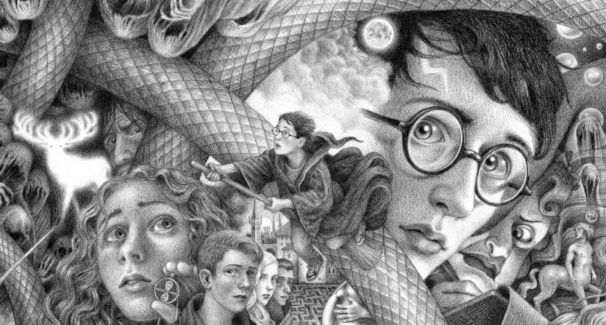

<h1 align="center">The Wizarding World — My Favorite Film Series</h1>

<p align="center"><em>Eight films, one castle, and a story I have re-watched more times than I can count.</em></p>

<p align="center">
  
</p>

<p align="center">
  <a href="https://www.imdb.com/title/tt0241527/"></a>
  <a href="https://www.wizardingworld.com/"></a>
  <a href="#at-a-glance"></a>
  <a href="#houses-of-hogwarts"></a>
</p>

---

## Contents

- [At a Glance](#at-a-glance)
- [Ranking All Eight Films](#ranking-all-eight-films)
- [Houses of Hogwarts](#houses-of-hogwarts)
- [My Top 5 Characters](#my-top-5-characters)
- [Spell Cheat Sheet](#spell-cheat-sheet)
- [Rewatch Marathon Plan](#rewatch-marathon-plan)
- [Trivia &amp; Easter Eggs](#trivia--easter-eggs)
- [Lines I Quote Too Often](#lines-i-quote-too-often)
- [Where to Watch](#where-to-watch)

---

## At a Glance

|  |  |
| --- | --- |
| **Based on** | The seven *Harry Potter* novels by J.K. Rowling |
| **Studio** | Warner Bros. Pictures |
| **Director(s)** | Chris Columbus, Alfonso Cuarón, Mike Newell, David Yates |
| **Music** | John Williams (*Sorcerer's Stone* to *Prisoner of Azkaban*) |
| **Filming home** | Warner Bros. Studios, Leavesden, England |
| **Total runtime** | ≈ 1,178 minutes (about 19.6 hours)[^1] |
| **My rating** | ⭐⭐⭐⭐⭐ 9.5 / 10 |

## Ranking All Eight Films

| Rank | Film | Year | My score | One-line verdict |
| :--: | :--- | :--: | :--: | :--- |
| 1 | *Prisoner of Azkaban* | 2004 | 10/10 | The one that turned the series into *cinema*. |
| 2 | *Deathly Hallows Part 2* | 2011 | 9.5/10 | The payoff is worth every hour before it. |
| 3 | *Order of the Phoenix* | 2007 | 9/10 | Slow in places, but Umbridge is unforgettable. |
| 4 | *Half-Blood Prince* | 2009 | 9/10 | The most beautiful cinematography of the eight. |
| 5 | *Goblet of Fire* | 2005 | 8.5/10 | Best set pieces, messiest adaptation. |
| 6 | *Sorcerer's Stone* | 2001 | 8.5/10 | Pure childhood nostalgia. |
| 7 | *Chamber of Secrets* | 2002 | 8/10 | Long, but the mystery still holds up. |
| 8 | *Deathly Hallows Part 1* | 2010 | 8/10 | A quiet road movie that needed more momentum. |

> **Honest take:** the films are *good* adaptations, not perfect ones. Several book scenes (the Hogwarts kitchens, the Sphinx, most of Dobby's screen time) were cut — which is why I always tell people to read the books *after* watching.

## Houses of Hogwarts

- **Gryffindor** 🦁 — *courage*
  - Colors: scarlet and gold
  - Ghost: Nearly Headless Nick
  - My honest note: loud, loyal, and slightly reckless.
- **Slytherin** 🐍 — *ambition*
  - Colors: green and silver
  - Ghost: the Bloody Baron
  - My honest note: the most misunderstood house in the series.
- **Ravenclaw** 🦅 — *wit*
  - Colors: blue and bronze
  - Ghost: the Grey Lady
  - My honest note: **my house** — Luna and Cho are both here.
- **Hufflepuff** 🦡 — *loyalty*
  - Colors: yellow and black
  - Ghost: the Fat Friar
  - My honest note: unfairly treated as the "leftover" house.

## My Top 5 Characters

1. **Luna Lovegood** — *the only person who never pretends to be someone else.*
2. **Severus Snape** — the most re-readable character in the whole series; every rewatch changes him.
3. **Hermione Granger** — the actual engine of the plot; the trio would have died in book one without her.
4. **Neville Longbottom** — the best arc: from comic relief to the one who stands up first.
5. **Minerva McGonagall** — quietly the most competent adult in the castle.

## Spell Cheat Sheet

```yaml
# The spells I would actually use in daily life
spells:
  - name: Lumos
    type: Charm
    effect: Creates light at the wand tip
    use_case: Brownouts during typhoon season
  - name: Accio
    type: Charm
    effect: Summons an object toward the caster
    use_case: Fetching my phone from across the room
  - name: Reparo
    type: Charm
    effect: Repairs a broken object
    use_case: My broken earphones, every single month
  - name: Expecto Patronum
    type: Defensive Charm
    effect: Conjures a silver guardian from a happy memory
    use_case: The finals week dementors
```

## Rewatch Marathon Plan

- [x] Watch all eight films once a year
- [x] Read all seven books at least twice
- [x] Visit the *Harry Potter* studio tour
- [ ] Watch the *Fantastic Beasts* trilogy in one sitting
- [ ] Listen to the audiobooks (Stephen Fry version)
- [ ] Finish a full re-read before the HBO series comes out

## Trivia &amp; Easter Eggs

<details>
<summary><strong>Click to reveal: the "19 years later" detail most people miss</strong></summary>

In the epilogue, Albus Severus Potter is the only one of Harry's children who is nervous about being sorted. Harry tells him that the Sorting Hat takes your choice into account — a line that pays off the very first conversation Harry ever has with the Hat in *Sorcerer's Stone*.

</details>

<details>
<summary><strong>Click to reveal: the number 7 is everywhere</strong></summary>

Seven books, seven Horcruxes (including Harry), seven years at Hogwarts, seven Weasley children, and Ginny is the seventh child and first daughter in seven generations. The production design team even hid the number in the Great Hall ceiling.

</details>

<details>
<summary><strong>Click to reveal: the film that almost was</strong></summary>

*Prisoner of Azkaban* was nearly directed by Guillermo del Toro. Alfonso Cuarón got the job instead, and he famously asked the trio to write essays about their characters before filming started.

</details>

## Lines I Quote Too Often

> "Happiness can be found even in the darkest of times, if one only remembers to turn on the light."

> "It does not do to dwell on dreams and forget to live."

> "We've all got both light and dark inside us. What matters is the part we choose to act on."

## Where to Watch

| Platform | Availability | Note |
| :--- | :---: | :--- |
| HBO Max | ✅ | All eight films, plus the reunion special |
| Prime Video | ✅ | Rent or buy per film |
| Netflix PH | ❌ | Licensing changes per region |
| Local DVD / Blu-ray | ✅ | My own copy — still the most reliable |

---

## About This Repository

This `README.md` is my submission for **CITE1008 — Application Development**, Pre-Final Performance Task (Individual Work).

It uses a mix of Markdown and light HTML: a centered header, badges, tables, ordered and unordered lists (with nesting), a YAML code block, task lists, collapsible `<details>` sections, blockquotes, a footnote, and inline formatting such as **bold**, *italic*, ***bold italic***, ~~strikethrough~~, and `inline code`.

**Author:** Nikay Magluyan
**Section:** BSIT 3E
**Date:** November 2026

---

<sub>Note: all film titles, characters, and trademarks belong to Warner Bros. and J.K. Rowling. This page is a personal, non-commercial fan write-up for a school activity.</sub>

[^1]: Runtime computed from the eight theatrical releases (159 + 161 + 142 + 157 + 138 + 153 + 146 + 130 minutes).
